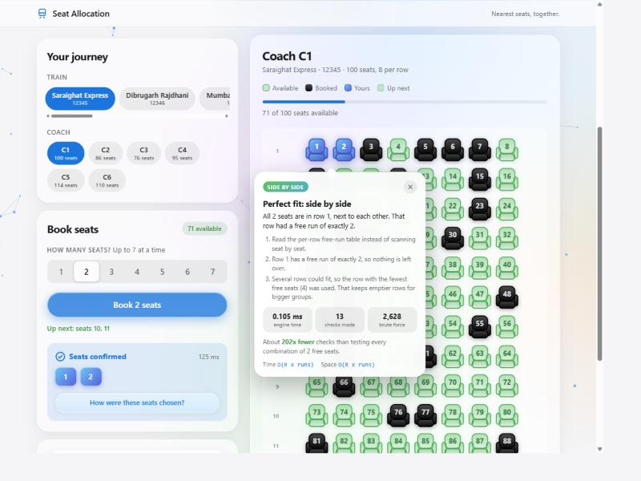
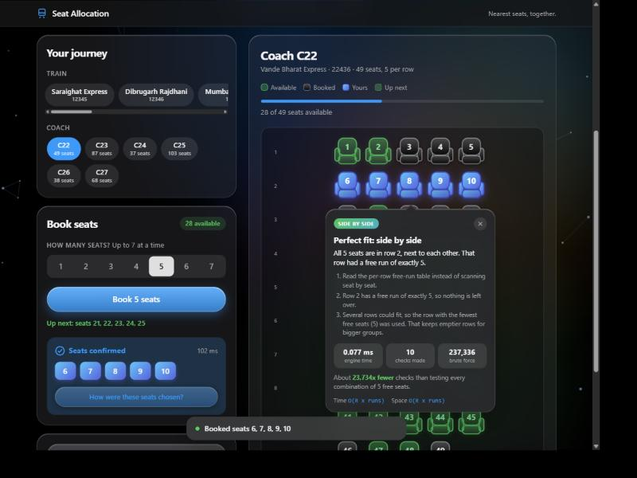
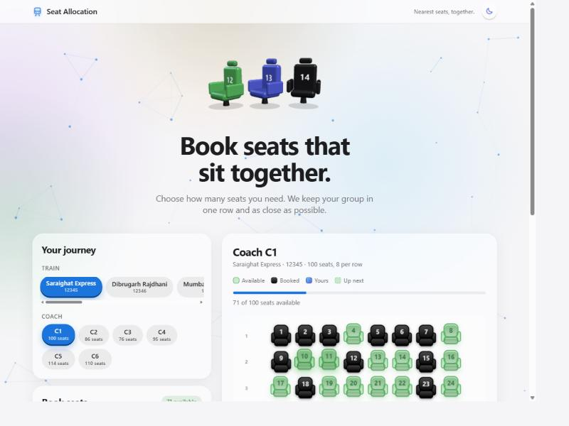
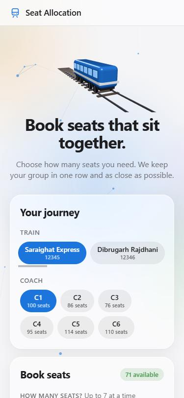

# Seat Allocation System

A train seat booking app (Angular + Express + MongoDB) that books groups of up to 7 passengers **as close together as possible**, and shows you exactly how it picked the seats.

**[Live demo](https://seat-allocation-fullstack.vercel.app/)** · Built by [@srvraj311](https://github.com/srvraj311) · [srvraj311.vercel.app](https://srvraj311.vercel.app)

| Light | Dark |
| --- | --- |
|  |  |

| Hero (three.js seats, light) | Mobile |
| --- | --- |
|  |  |

## Problem statement

1. A coach has `n` seats with `r` seats in a row.
2. One person can reserve up to 7 seats at a time.
3. Seats are booked in one row if possible.
4. If no row has room, the seats must be booked as near each other as possible.
5. Users can keep booking until the coach is full.
6. Proper backend with a database.
7. Multiple trains, each with multiple coaches.

Input is only the number of seats. Output is the booked seat numbers plus a view of every seat's status. Some seats are already booked when you open a coach, so the algorithm has to work around them.

## Features

- **Seat map** with real seat icons: available (green), booked (black), yours (blue), and "up next" (see below).
- **Up-next preview.** Before you book, the seats you would get shake gently on the map, and shake harder while you hover the Book button. The preview comes from the server using the exact same engine as the real booking.
- **Algorithm popover.** After each booking a popover over the new seats explains which method was used and why, with engine time, number of checks, the brute-force comparison and the time/space complexity.
- **3D UI.** The hero is three glossy three.js seats (green, blue, black) that float and follow the pointer, shake while a booking is in flight, and spin your blue seat with a confetti burst when it succeeds. The seat map itself tilts toward the pointer with seats lifted in CSS 3D (hovered seats rise, booked seats sit pressed down), buttons and chips are raised keycaps that press in, and icons flip in 3D. three.js loads lazily, pauses when off screen, and reduced-motion users get a still frame.
- **Dark / light toggle** in the header. Dark is the default and the choice is remembered.
- **Apple-style glass UI.** Frosted cards and buttons, animated particle background, light and dark mode, responsive down to phones.
- **Proper loading and error states.** Top progress bar, skeleton placeholders, button spinners, toasts instead of `alert()`, retry on load errors, two-tap reset confirmation.
- **10 seeded Indian trains** (Saraighat Express, Mumbai Rajdhani, Vande Bharat Express, ...) with random coaches of 30-120 seats and 2-8 seats per row.

## How seats are chosen

Implemented in [`lib/bookingService.js`](lib/bookingService.js). A coach is a binary matrix (`0` free, `1` booked). For every row the engine keeps a **free-run table**: the list of contiguous free stretches `{ start, len }`.

For a request of `k` seats:

| Step | Strategy | What happens | Cost |
| --- | --- | --- | --- |
| 1a | **Perfect fit** | A row has a free run of exactly `k`. The tightest such row (fewest free seats overall) wins, so emptier rows stay available for bigger groups. | O(R x runs) |
| 1b | **Best fit** | No exact run, so use the smallest run longer than `k`. | O(R x runs) |
| 2 | **Compact window** | No run is long enough. For windows of `h = 1, 2, 3 ...` consecutive rows, a two-pointer sweep over the per-column free counts finds the narrowest column span holding `k` free seats. The cost of a candidate is `(rows spanned - 1) + (columns spanned - 1)`, the Manhattan size of the group's bounding box. The cheapest window wins and the `k` free seats nearest its centre are taken. Windows taller than the best cost so far are skipped. If the best window is a single row, the seats are in one row with small gaps. | O(R x h x C) time, O(C) extra space |

Why it is fast: steps 1a and 1b never look at individual seats, they only read the run table. Step 2 prunes any window that cannot beat the best box found so far. A brute-force search would have to test every one of the `C(free, k)` seat combinations, which is millions for a typical coach (the popover shows the exact number next to the checks the engine actually made).

Correctness: for coaches where no free run is long enough, the compact-window result was compared against an exhaustive search over about 1,200 random small coaches and always matched the tightest possible group. When a row run of exactly `k` exists it is preferred even if a 2-D block would have a slightly smaller bounding box, because the problem asks for same-row priority.

The booking endpoint returns an `explain` object with the strategy, a plain-language summary, the steps, and the metrics that the popover renders.

## Architecture

```
Client (Angular 17)  --HTTP-->  Express API  -->  MongoDB (Mongoose)
 state + three.js               lib/bookingService.js   collections: train, coach
```

- **Client** (`Client/`): `DataService` holds all UI state in one observable, `BookingService` orchestrates actions, and components (`app`, `booking`, `seat`, `seat-item`, `background`, `hero3d`) render it.
- **Server** (`index.js`): thin REST layer. All allocation logic is in `lib/bookingService.js`.
- **Production**: the server also serves the built Angular app from `Client/dist/seat_allocation_d2c`.

### Database

Collection `train`:

```json
{ "train_no": 12345, "name": "Saraighat Express", "coach": [1, 2, 3, 4, 5, 6] }
```

Collection `coach`:

```json
{
  "train_id": 12345,
  "coach_id": 1,
  "totalSeats": 100,
  "seatsInRows": 8,
  "availableSeats": 73,
  "bookingState": [[0, 1, 0, 0, 1, 0, 0, 1], [...]]
}
```

`bookingState` is the matrix of rows, `0` = free, `1` = booked. The only schema change from the original project is the optional `name` on `train`.

### API

| Method | Route | Description |
| --- | --- | --- |
| GET | `/trains` | List trains |
| POST | `/trains/add` | Add a train `{ train_no, name?, coach }` |
| GET | `/coach/:train_id` | Coaches of a train |
| POST | `/coach/add` | Add a coach |
| POST | `/coach/:id` | Update `bookingState` and `availableSeats` |
| GET | `/booking/preview/:coachId/:num` | Which seats the next booking would get (nothing is booked) |
| GET | `/booking/:coachId/:num` | Book `num` seats (1-7). Returns `{ coach, bookedSeat, explain }` |
| GET | `/booking/random/:coachId` | Fill the coach with random bookings |
| GET | `/booking/clear/:coachId` | Reset the coach |

Errors come back as JSON with a 400 (bad request, coach full, not enough seats) or 404 (unknown coach).

## Run it locally

Requirements: Node 20+ and a MongoDB database (local or Atlas).

1. Install dependencies.

   ```bash
   npm install
   cd Client && npm install --legacy-peer-deps && cd ..
   ```

   `--legacy-peer-deps` is needed because of an Angular peer-version conflict.

2. Create a `.env` file in the project root (it is git-ignored).

   ```
   MONGO_URI=mongodb+srv://<user>:<password>@<cluster>/?retryWrites=true&w=majority
   ```

   Without a database name in the URI, Mongoose uses the `test` database.

3. Seed the database.

   ```bash
   npm run seed
   ```

   This upserts 10 Indian trains with 3-6 coaches each, 30-120 seats per coach and 2-8 seats per row, with 15-55% of seats pre-booked. It never deletes anything, so running it again just refreshes the seed data.

4. Build the client and start the server.

   ```bash
   cd Client && npm run build && cd ..
   npm start
   ```

5. Open http://localhost:3000.

For client development with live reload, run `npm start` in `Client/` (port 4200). The client calls the API on the same origin, so for that setup use a proxy to port 3000 or just rebuild and reload.

## Deploy

The repo includes `vercel.json`, which serves the Express app and the built client. Set `MONGO_URI` in the Vercel project settings and commit `Client/dist` (the build output is tracked in this repo).

## What changed in the redesign

- New Apple-style UI: system font, frosted glass, animated background, light and dark mode with a header toggle (dark by default). Angular Material and Bootstrap were removed.
- Seats are drawn as SVG seat icons with distinct available, booked and yours states.
- 3D UI: three.js seat hero, tilting seat map with raised seats, keycap-style buttons, 3D flip when your seats are confirmed.
- Allocation logic moved out of `index.js` into `lib/bookingService.js` and rewritten: tightest-fit row choice, compact multi-row search, 1-based seat numbers, server-side validation, and an `explain` payload.
- Fixed: the old code picked the wrong row in one case (it used an index instead of the row number), seat numbers were off by one, the full-screen spinner could get stuck, requests were re-subscribed on every click, and the server crashed on a missing or full coach.
- Mongoose 8 removed callback APIs, so `/trains/add`, `/coach/add` and `/coach/:id` were broken. They now use async/await.
- Known limitation: two people booking the same coach at the same instant can overwrite each other. Fixing that needs optimistic locking, which was left out to keep the schema unchanged.

## Credits

Original assignment solution by Sourabh ([@srvraj311](https://github.com/srvraj311)). Redesign and algorithm rework in 2026. Site: [srvraj311.vercel.app](https://srvraj311.vercel.app).
